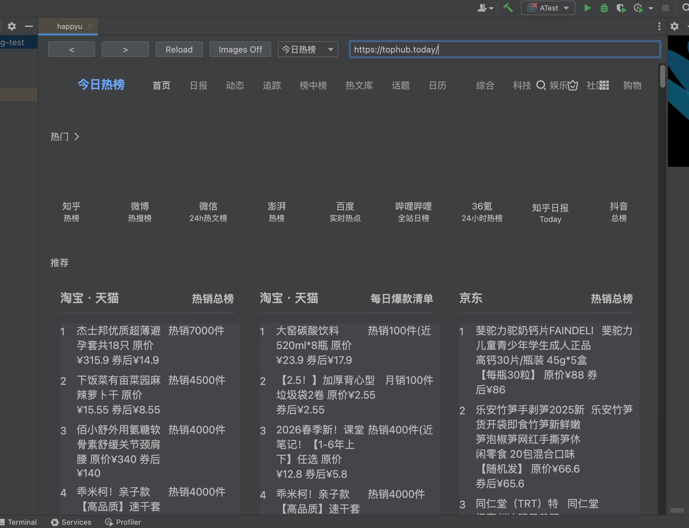
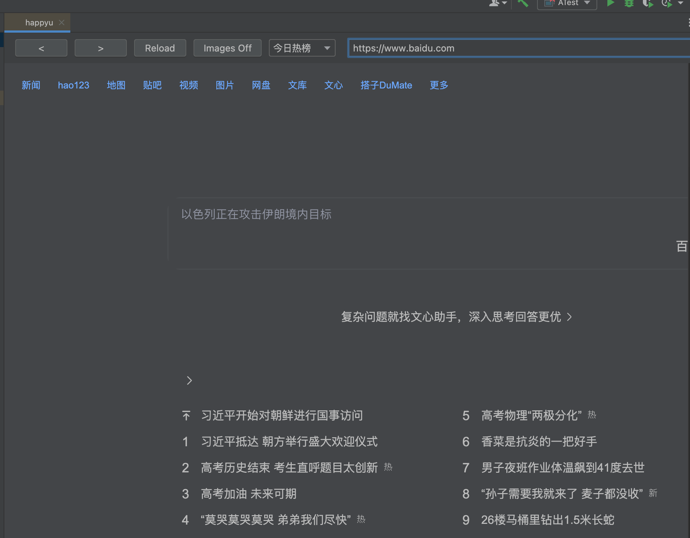

# happyu

当前版本：`0.1.3`。




happyu 是一个给 IntelliJ IDEA 用的低调摸鱼浏览器插件。

它会在 IDEA 侧边的 happyu 工具窗口中打开网页，支持多个网页标签。插件默认屏蔽图片、视频、favicon 等媒体资源，并把网页尽量处理成文字优先的阅读模式。页面颜色会跟随 IDEA 当前主题，适合在休息间隙低调浏览搜索结果、热搜、榜单、文档和其他文字内容。

简单说：想看点网页，但又不想离开 IDEA，也不想让页面花花绿绿太显眼，就用它。

## 功能

- 点击右侧工具栏的 `happyu`，或通过 `Tools -> Open happyu` 打开浏览器工具窗口。
- 点击窗口标题栏的 `+` 新建网页标签；可切换、关闭标签，网页标题会自动更新到标签上。标题栏按钮保持显示，移开鼠标后标签栏不会占用按钮区域。
- 标签较多时，将鼠标放在标签栏上滚动滚轮，可平滑横向查看超出宽度的标签；单位步长为 16（随 IDE 缩放和系统滚动量调整），连续滚动时保持速度衔接，反向滚动会立即转向，当前页面保持不变。
- 自动保存未关闭标签页的网址、顺序、标题、图片开关和当前选中项，重新打开项目后恢复。恢复时只加载选中的网页，其他标签切换时再加载。
- 右键点击已加载的后台标签，选择 `Sleep Tab` 可手动休眠；休眠标签显示 `[Sleeping]`，点击后按最后的网址重新加载。
- 在 `Settings -> Tools -> happyu` 中可开启自动休眠并设置闲置时间（默认关闭，默认时长为 15 分钟，可设为 1～1440 分钟）。后台闲置从切换离开标签时开始计算，每约 30 秒检查一次，当前选中的标签不会休眠。
- 原本要求新窗口打开的网页链接会在工具窗口内新建标签。
- 可通过 IDEA 工具窗口菜单移动到左侧、底部，或切换为浮动窗口。
- 默认打开的首页为 `https://www.baidu.com/`。
- 可自由输入网址。
- 每个网页标签提供独立的地址栏、返回、前进、刷新、图片开关和缩放百分比选项。缩放菜单提供 25%～500% 的常用比例，`100% (Default)` 标识默认缩放；使用 `Ctrl+滚轮` 缩放页面时，菜单会同步实际比例。切换比例无需刷新页面，比例随标签页保存并在休眠唤醒后恢复。
- 在 `Settings -> Tools -> happyu` 开启 `Automatically hide the address toolbar` 后，顶部网址栏及导航按钮会自动收起，鼠标移到浏览器顶部边缘时覆盖显示在网页上方，移开约 300 毫秒后隐藏；展开和收起不调整网页尺寸，编辑网址或打开缩放菜单时保持显示。浮层跟随 IDEA 窗口，切换标签或隐藏工具窗口时收起。默认关闭，设置独立保存到 `.idea/happyu-settings.xml`，对所有标签页立即生效。
- 默认屏蔽图片、favicon、视频等媒体资源，并注入 CSS 隐藏图片、背景图、视频、canvas 等元素。
- 快捷键 `Ctrl+Alt+I` 切换图片屏蔽状态。macOS 上如果和系统快捷键冲突，可在 IDEA 的 Keymap 里调整 `Toggle happyu Images`。
- 网页背景色、文字色、链接色会按 IDEA 当前明暗主题重新注入。
- 点击标题栏的对话图标可开关底部 Agent 风格输入面板，也可在 `Settings -> Tools -> happyu` 中设置；默认关闭，开关状态保存在 `.idea/happyu-settings.xml`。拖动面板顶部横条可调整高度，支持输入、`Enter` 本地发送、`Shift+Enter` 换行及模式/模型外观选择，只用于本地伪装，不连接模型、不发送或持久化输入内容。
- 点击标题栏的阅读图标可开启 `Agent Reading Mode`，也可在设置中开启 `Use Agent conversation style for web reading`。它会优先提取 main/article 正文，按用户请求和 Agent 回复的样式显示标题、段落、列表、代码、表格及链接；再次点击图标即可返回原网页，无需重新加载。底部输入面板可以独立搭配使用，两个开关都会保存。

阅读模式只在本地提取当前页面的内容，不连接模型，不复制网页脚本或表单。正文图片显示为 `imageView · 文件名` 卡片，支持常见懒加载地址及 `picture`；点击后才加载预览图，预览跟随 IDE 明暗主题。预览支持滚轮围绕鼠标位置缩放、放大后拖动查看，提供缩放百分比、放大/缩小、适应窗口和原始大小按钮；也可用 `+`/`-` 缩放、`0` 适应窗口、`1` 查看原始大小，不改变网页缩放比例。可通过关闭按钮、点击遮罩或 `Esc` 关闭，保留正文滚动位置。图片屏蔽开启时也可单独预览所点击的图片，无需打开整页图片；关闭预览、跳转页面或休眠后清除临时放行。已缓存楼层中的图片入口在原节点卸载后仍可使用，图片加载失败时可重试。贴吧行内表情以简短文字占位。

正文变化和展开操作会自动合并刷新，也可点击“刷新正文”手动更新；向下滚动会联动原网页及内层滚动区域，触发网站自身的滚动加载或明确的“加载更多”按钮。分页页面的底部按钮显示“下一页”，点击后调用原网页分页；加载过程中及暂未收到新内容时都会显示提示。正文中的同页目录链接会定位阅读视图，自动展开目标所在的楼层及楼中楼，并避开顶部工具栏；目标未提取时显示提示，不滚动被覆盖的原网页。识别楼层时同时参考常见结构和“第几楼”标记，每层显示为独立可折叠卡片，楼中楼回复以独立气泡显示；支持“查看/展开回复”“1 回复”等入口，以及挂载在正文外的回复弹窗。贴吧页面还支持“只看楼主”“正序”“倒序”操作。刷新会保留卡片展开状态，并尽量保持当前楼层的阅读位置。

阅读模式开启时会隔离原网页的键盘焦点，避免 Tab、输入或回车操作被遮挡的表单；原网页的滚动加载及阅读按钮代理仍正常工作。退出时恢复页面原有的 `inert` 属性、焦点和滚动位置，不清空表单内容。

贴吧新旧版页面均按楼层卡片和可折叠的楼中楼气泡展示；吧内列表按置顶帖子和普通帖子显示，标题保留原链接。旧版会提取楼层正文和发帖时间，移除作者头像、等级徽章及发帖控件，并保留楼中楼的“点击查看”和分页入口。对于新版贴吧的虚拟列表，阅读模式按帖子 ID 保留已经提取的楼层，原网页卸载旧节点后仍可阅读已加载的文字和回复。楼层编号取自原网页自身的楼层信息，节点重建时保留已确认的编号；无法确认时显示“楼层回复”，不会按新一批内容的位置重新编号。下滑至末尾或点击加载会逐段推进原网页，保持阅读区当前位置；排序和“只看楼主”等筛选会重建结果。原网页已卸载楼层的“加载更多回复”入口会暂时禁用，已提取的回复仍可本地展开。

动态更新有频率限制，提取按小批次执行，后台页面暂停处理，关闭阅读模式后移除监听并恢复原网页滚动位置。贴吧阅读历史只留在当前页面内存中，最多保留 500 条帖子卡片及约 100 万字符，达到上限后会显示提示；关闭阅读模式、跳转页面或休眠后释放。不同网站结构、登录要求和加载机制可能影响识别与展开，未识别的页面按普通正文展示；登录、发表回复、提交表单和复杂交互请切回原网页操作。特别长的页面仍会提示截取范围，可切回原网页阅读全文。

标签页状态和休眠标记通过 IDEA 持久化服务独立保存在项目的 `.idea/happyu-tabs.xml`，休眠设置保存在 `.idea/happyu-settings.xml`，不写入 `workspace.xml`。它们保存标签页信息，不保存页面内容、前进后退历史或 Cookie，登录状态仍由 JCEF 管理。

休眠会释放该标签的浏览器实例，保留网址、标题和图片开关。唤醒时重新加载，未提交表单、页面内存状态和前进后退历史可能丢失。插件不会主动清除 Cookie，但部分网站仍可能需要重新登录。当前版本不会检测后台表单、播放或上传任务，开启自动休眠前请留意这些页面。

## 兼容版本

- IntelliJ IDEA 2024.1 到 2026.3 系列。
- 对应 IntelliJ Platform build：`241` 到 `263.*`。

## 运行

```bash
./gradlew runIde
```

如果本机已经安装 IntelliJ IDEA，也可以使用本地 IDE SDK：

```bash
gradle runIde -PideaLocalPath="/Applications/IntelliJ IDEA.app/Contents"
```

## 打包

```bash
./gradlew buildPlugin
```

生成的插件包在 `build/distributions/`。

## 浏览器卡住时收集诊断

Windows 下，如果 happyu 和其他 JCEF 插件同时卡住，但代码编辑正常，请在重启 IDEA 前运行：

```powershell
powershell -NoProfile -ExecutionPolicy Bypass -File scripts/Collect-JcefDiagnostics.ps1
```

脚本通过本机 JDK 的 `jcmd` 连续抓取 3 份原始线程转储，记录 IDEA/JCEF 进程信息，并复制最近的 IDEA/JCEF 日志。结果保存在 `build/diagnostics/jcef-时间戳/`，不会重启或终止 IDEA/JCEF。

如果同时运行多个 IDEA 实例，使用 `-IdeaProcessId 进程号` 指定卡住的实例；自定义日志目录时可传入 `-LogDirectory "日志目录"`。

## 开源协议

本项目基于 [MIT License](LICENSE) 开源。
